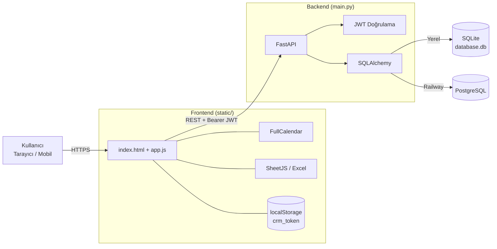
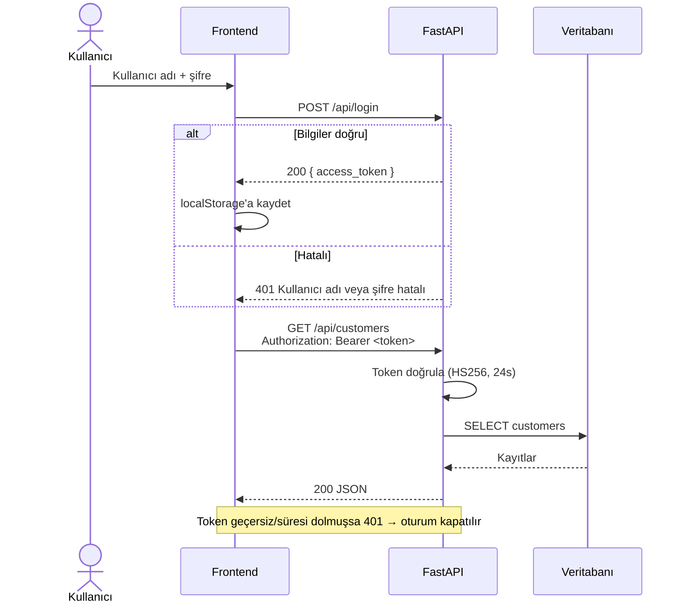
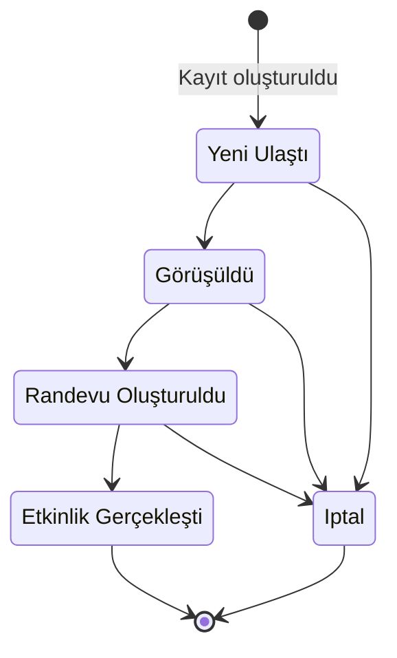
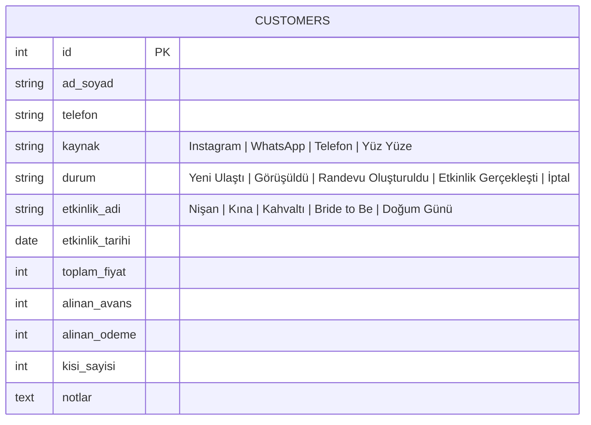
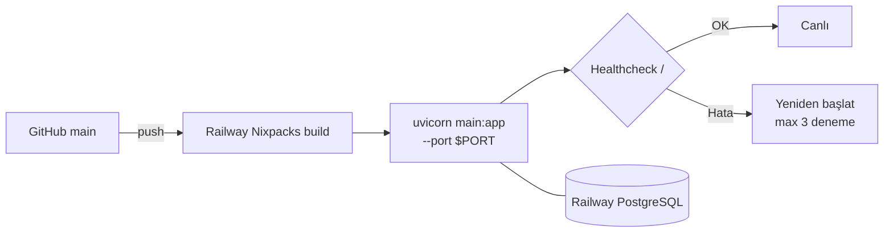

# Nazay Bahçe CRM

Nazay Bahçe için geliştirilmiş, etkinlik (nişan, kına, kahvaltı, doğum günü vb.) odaklı hafif bir müşteri takip ve ön muhasebe uygulaması. Müşteri kayıtları, etkinlik takvimi, kapora/tahsilat takibi ve Excel dışa aktarımı tek bir sayfada sunulur.

## Özellikler

- **JWT ile oturum açma** — 24 saat geçerli Bearer token
- **Müşteri yönetimi** — ekleme, düzenleme, görüntüleme, silme
- **Filtreleme** — kaynağa, duruma ve etkinlik türüne göre
- **Liste ve takvim görünümü** — FullCalendar (Türkçe yerelleştirme)
- **Finansal özet** — toplam ciro, verilen kaporalar, bekleyen tahsilat, aylık özet
- **Excel dışa aktarım** — SheetJS ile `.xlsx`
- **WhatsApp bağlantısı** — telefon numarasından tek tıkla sohbet
- **Mobil uyumlu arayüz**

## Teknoloji Yığını

| Katman | Teknoloji |
|---|---|
| Backend | Python, FastAPI, Uvicorn |
| ORM / DB | SQLAlchemy · SQLite (yerel) / PostgreSQL (prod) |
| Kimlik doğrulama | python-jose (JWT, HS256) |
| Frontend | Vanilla JS, HTML, CSS (SPA) |
| Kütüphaneler | FullCalendar 5.11.3, SheetJS 0.20.0 |
| Dağıtım | Railway (Nixpacks) |

## Mimari



## Kimlik Doğrulama Akışı



## Müşteri Durum Akışı



> Not: Durum geçişleri şu an backend tarafında zorlanmıyor; yukarıdaki akış iş sürecini tarif eder.

## Veri Modeli



**Bekleyen tahsilat** = `toplam_fiyat − alinan_avans − alinan_odeme`

## API Uç Noktaları

| Metot | Yol | Açıklama | Auth |
|---|---|---|---|
| `POST` | `/api/login` | Token al | — |
| `GET` | `/api/customers` | Listele (`kaynak`, `durum`, `etkinlik_adi` sorgu filtreleri) | ✅ |
| `GET` | `/api/customers/{id}` | Tekil müşteri | ✅ |
| `POST` | `/api/customers` | Yeni müşteri | ✅ |
| `PUT` | `/api/customers/{id}` | Güncelle | ✅ |
| `DELETE` | `/api/customers/{id}` | Sil | ✅ |
| `GET` | `/{path}` | SPA (`static/index.html`) | — |

Etkileşimli dokümantasyon: `http://127.0.0.1:8000/docs`

## Kurulum (Yerel)

```bash
python -m venv venv
venv\Scripts\activate
pip install -r requirements.txt
uvicorn main:app --reload
```

Windows'ta alternatif olarak `baslat.bat` çalıştırılabilir; sunucuyu başlatır ve tarayıcıyı `http://127.0.0.1:8000` adresinde açar.

### Ortam Değişkenleri

| Değişken | Açıklama | Varsayılan |
|---|---|---|
| `DATABASE_URL` | Veritabanı bağlantısı (`postgres://` otomatik `postgresql://`'e çevrilir) | `sqlite:///./database.db` |
| `SECRET_KEY` | JWT imzalama anahtarı — **prod'da mutlaka ayarlanmalı** | geliştirme değeri |

## Dağıtım (Railway)



Yapılandırma: `railway.toml` ve `Procfile`.

## Proje Yapısı

```
nazay-crm/
├── main.py            # FastAPI uygulaması, modeller, auth, endpoint'ler
├── requirements.txt
├── Procfile           # Railway/Heroku başlatma komutu
├── railway.toml       # Railway build/deploy ayarları
├── baslat.bat         # Windows yerel başlatıcı
└── static/
    ├── index.html     # SPA iskeleti
    ├── app.js         # İstemci mantığı (API, takvim, istatistik, Excel)
    └── style.css      # Stil + mobil uyum
```
